# Keel

A C compiler toolchain written in Rust: preprocessor, frontend, SSA optimizer,
native backend, assembler, archiver and linker. Compiling C to an object file
never invokes Clang.

<p align="center"></p>

Every stage is also a standalone command, so you can start or stop anywhere in
the pipeline.

## Install

```sh
cargo install --path crates/keel
```

Requires a Rust toolchain with edition 2024 support.

## Usage

Compile and link a C program (macOS arm64):

```sh
keel cc -O --emit-object hello.c -o hello.o
keel link hello.o -o hello
./hello
```

Run any stage on its own:

```sh
keel cc --emit-ir hello.c -o hello.keel        # C → Keel IR
keel opt -p gvn,dce hello.keel                 # run optimizer passes
keel compile -O --emit-object hello.keel -o hello.o
keel asm input.s -o input.o                    # standalone assembler
keel archive -o libinput.a input.o             # static archive
```

Omit `--emit-object` to get assembly text. Use `--target` to cross-compile,
e.g. `--target x86_64-unknown-linux-gnu`; hosted programs still need that
platform's sysroot (`--sysroot`).

Compile freestanding C to WebAssembly:

```sh
keel cc --target wasm32-unknown-unknown --emit-wasm --export add add.c -o add.wasm
```

## Platforms

| | macOS arm64 | Linux AArch64 | Linux x86-64 | wasm32 |
| --- | :---: | :---: | :---: | :---: |
| C compiler | ✓ | ✓ | ✓ | integer/pointer subset |
| Output | Mach-O | ELF | ELF | `.wasm` module |
| Assembler | ✓ | ✓ | ✓ (Intel, AT&T) | — |
| Linker | ✓ | ✓¹ | ✓¹ | — |

¹ Native ELF links need caller-supplied startup code; `keel link --system`
links hosted programs through the system driver.

C support targets C11 with common GNU extensions (vectors, VLAs, attributes,
complex numbers, AArch64 inline assembly). See [C coverage](docs/c-frontend-coverage.md)
and [ISA status](docs/userspace-isa-status.md) for the details and limits.

## Performance

Keel compiles quickly; the code it generates is not yet as fast as Clang's.
Measured on an Apple M5 Max. [Compiler](docs/benchmarks/compiler-20261024.md) ·
[assembler/linker](docs/benchmarks/assembly-link-20261024.md) ·
[runtime](docs/benchmarks/runtime-20261022.md) methodology

<p align="center"></p>

<p align="center"></p>

<p align="center"></p>

<p align="center"></p>

<p align="center"></p>

Charts are generated from the benchmark data by
[`docs/assets/readme-render-charts.py`](docs/assets/readme-render-charts.py).

## Documentation

- [Toolchain reference](docs/toolchain-overview.md): commands, flags, optimization tiers
- [Design](docs/design.md): IR, optimizer and backend architecture
- [C frontend](docs/c-frontend-coverage.md) · [SIMD IR](docs/simd-ir.md)
- [macOS linker](docs/macos-linker.md) · [ELF linker](docs/elf-linker.md) · [Static archives](docs/static-archives.md)
- [x86 assembler](docs/native-x86-assembler.md) · [ARM Linux](docs/arm-linux.md)
- [WebAssembly](docs/wasm-cli.md)
- [Benchmark and application suite](suite/README.md)

## Development

```sh
cargo build
cargo test --workspace
```

End-to-end tests need `clang` (and `clang++` for C++ drivers). See the
[development section](docs/toolchain-overview.md#development) for test layout.
Commits follow [Conventional Commits](https://www.conventionalcommits.org/).
